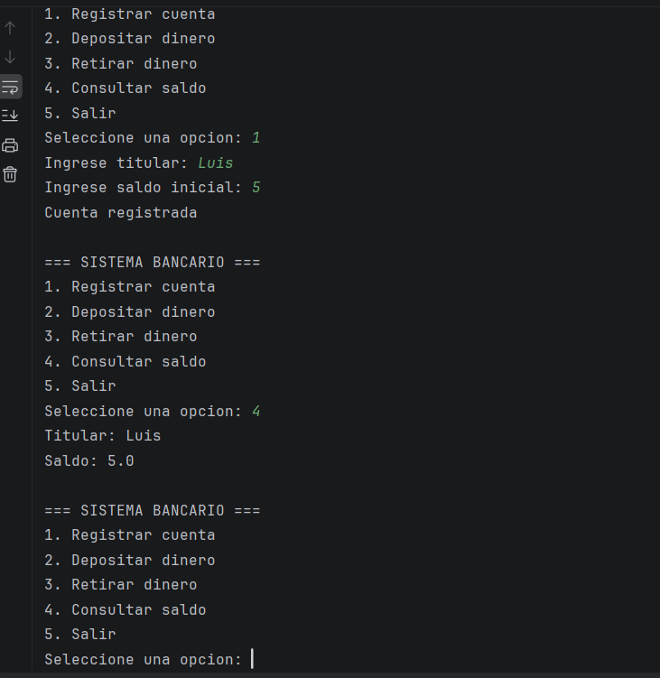

# Diagnóstico de arquitectura – código original `SistemaBancario`

## 1. Responsabilidades mezcladas en una sola clase

| # | Responsabilidad | Dónde está | Cambio de requisito que obligaría a modificar la clase |
|---|---|---|---|
| 1 | Capturar entrada | `Scanner` en atributo y en `main` | Cambiar consola por interfaz gráfica (JavaFX) o web |
| 2 | Validar operaciones | `if (monto > 0 && monto <= saldo)` | Nueva regla: monto mínimo, límite diario, comisión |
| 3 | Actualizar saldos | `saldo += monto`, `saldo -= monto` | Manejar varias cuentas o intereses |
| 4 | Escribir archivos | `guardarMovimiento()` con `FileWriter` | Cambiar archivo por base de datos (JDBC/H2) |
| 5 | Imprimir resultados | `System.out.println` en cada método | Cambiar mensajes, idioma o formato de moneda |
| 6 | Coordinar el flujo | `do/while` + `switch` en `main` | Agregar opciones nuevas (transferencias, historial) |
| 7 | Guardar el estado de la cuenta | atributos `titular`, `saldo` | Soportar más de una cuenta |

Conclusión: la clase tiene al menos **siete razones para cambiar**, por lo que viola el
Principio de Responsabilidad Única (SRP). Cualquier cambio (de UI, de reglas o de almacenamiento)
obliga a tocar el mismo archivo y arriesga romper las demás funciones.

## 2. Problemas identificados (verificados ejecutando el código original)

| # | Problema | Evidencia al ejecutar |
|---|---|---|
| D1 | Registrar otra cuenta **reemplaza** la anterior sin avisar | Registrar Ana (1000) y luego Luis (5) → consultar muestra `Titular: Luis`, `Saldo: 5.0`; Ana se pierde |
| D2 | Se puede depositar/retirar/consultar **sin cuenta** | Depositar 50 sin registrar → `Titular: null`, `Saldo: 50.0`, y se escribe `Titular: null` en movimientos.txt |
| D3 | Saldo inicial negativo y titular vacío aceptados | Titular vacío con saldo `-500` → `Cuenta creada \| Titular:  \| Saldo inicial: S/ -500.0` |
| D4 | `double` para dinero: errores de redondeo | 0.1 + 0.2 → `Saldo: 0.30000000000000004` |
| D5 | Dos `Scanner` sobre `System.in` | Con entrada redirigida, el primer Scanner se queda con todo el buffer → `NoSuchElementException` |
| D6 | No valida el tipo de dato | Escribir `abc` en el menú → `InputMismatchException`, el programa se cae |
| D7 | Errores de archivo ocultados | `catch` solo imprime "Error al guardar", sin detalle |
| D8 | Mensaje ambiguo | "Fondos insuficientes o monto invalido" no dice cuál de los dos ocurrió |
| D9 | No es testeable | Depende directamente de `System.in` y `FileWriter`; no se puede probar la lógica aislada |
| D10 | Historial ≠ persistencia | `movimientos.txt` registra eventos, pero al reiniciar la cuenta desaparece |
| D11 | Estilo | Indentación inconsistente en `guardarMovimiento`, saldo mostrado como `1000.0` sin "S/" |

Evidencia del defecto D1: 

## 3. Respuestas a las preguntas orientadoras

**¿Qué sucede si cambiamos el archivo por una base de datos?**
Habría que editar `SistemaBancario` (la misma clase que tiene el menú y las reglas), reemplazando
`FileWriter` por JDBC dentro de `guardarMovimiento()`. Se arriesga romper depósitos y retiros por un
cambio que solo debería afectar al almacenamiento.

**¿Por qué la entidad bancaria no debería utilizar Scanner o FileWriter?**
Porque la entidad representa reglas del negocio (qué es un depósito válido, cuándo se rechaza un
retiro), que son estables. `Scanner` y `FileWriter` son detalles técnicos que cambian con frecuencia.
Si la entidad los usa, queda atada a la consola y al archivo, no se puede reutilizar ni probar sola.

**¿Qué pasaría al registrar una cuenta distinta?**
Se sobrescriben `titular` y `saldo`: la cuenta anterior se pierde sin aviso (defecto D1).

## 4. Justificación de la refactorización
Se separó el sistema en tres capas con dependencias hacia adentro:
- **Dominio** (`CuentaBancaria`): reglas de montos y saldo → resuelve D3, D4 (BigDecimal), D8.
- **Aplicación** (`CuentaService`, `MovimientoRepository`): casos de uso y contrato de persistencia
  → resuelve D1 y D2; permite cambiar el almacenamiento sin tocar reglas (D9).
- **Infraestructura** (`ArchivoMovimientoRepository`, `Main`): detalles técnicos → resuelve D5, D6, D7.
  D10 se documenta y se advierte al usuario (la persistencia completa queda para el lab 7-B).