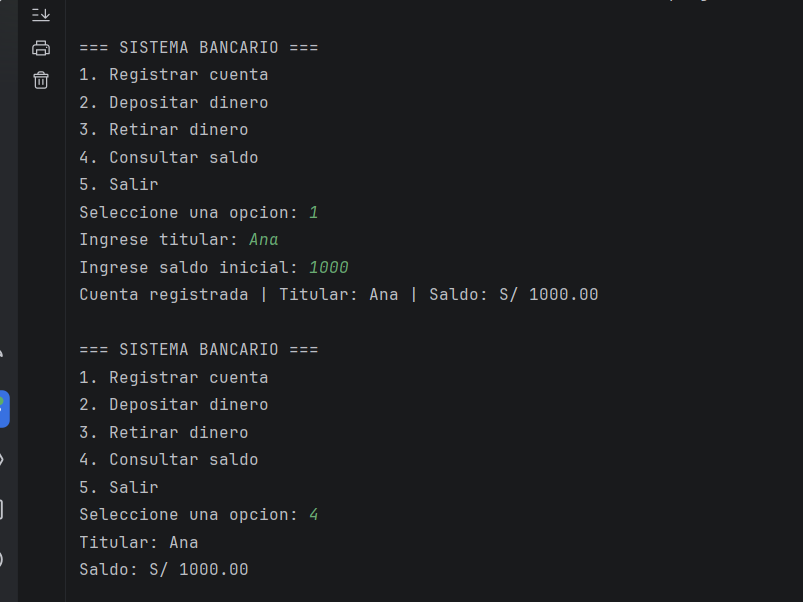
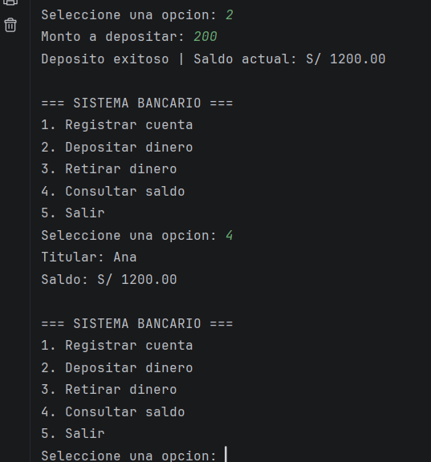
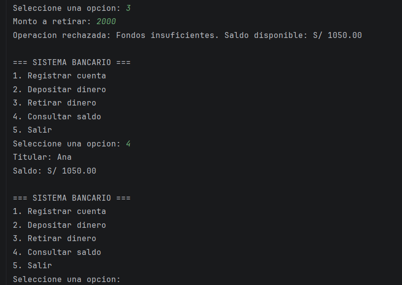
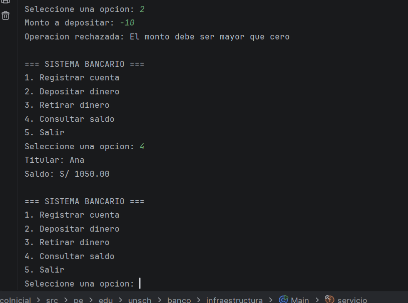
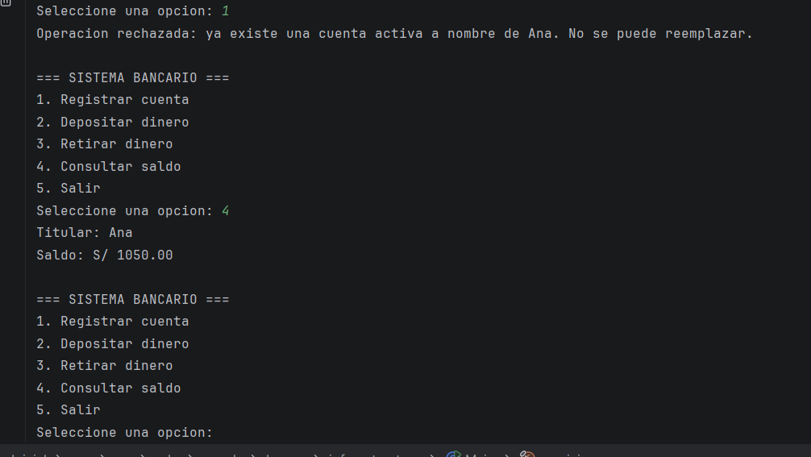
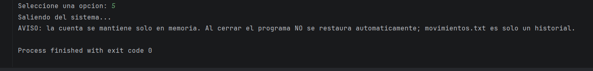
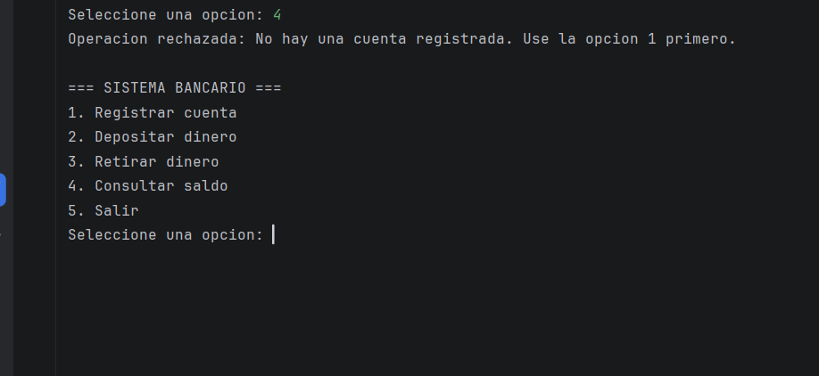
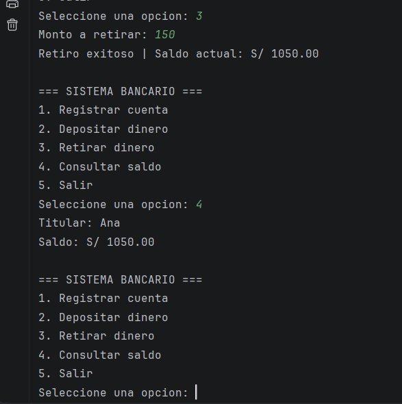
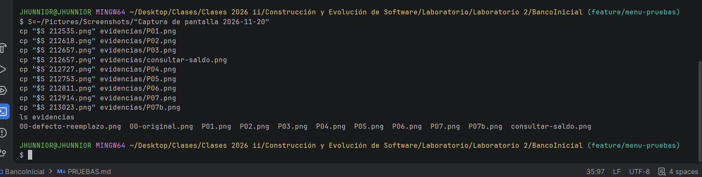

# Registro de pruebas – Laboratorio 07-A

**Entorno:** JDK 17+ · IntelliJ IDEA · ejecución de `pe.edu.unsch.banco.infraestructura.Main`
**Fecha:** 20/11/2026

## Resumen

| Caso | Acción | Resultado esperado | Resultado obtenido | Estado |
|---|---|---|---|---|
| P01 | Registrar a Ana con S/ 1000 | Cuenta registrada, saldo 1000 | `Cuenta registrada \| Titular: Ana \| Saldo: S/ 1000.00` | ✅ |
| P02 | Depositar S/ 200 | Saldo 1200; movimiento registrado | `Deposito exitoso \| Saldo actual: S/ 1200.00` + línea en movimientos.txt | ✅ |
| P03 | Retirar S/ 150 | Saldo 1050; movimiento registrado | `Retiro exitoso \| Saldo actual: S/ 1050.00` + línea en movimientos.txt | ✅ |
| P04 | Retirar S/ 2000 | Rechazada; saldo 1050 | `Operacion rechazada: Fondos insuficientes. Saldo disponible: S/ 1050.00` | ✅ |
| P05 | Depositar S/ -10 | Rechazada; saldo intacto | `Operacion rechazada: El monto debe ser mayor que cero`; saldo 1050.00 | ✅ |
| P06 | Registrar nueva cuenta sin reiniciar | No reemplaza la cuenta activa | `Operacion rechazada: ya existe una cuenta activa a nombre de Ana. No se puede reemplazar.`; consultar sigue mostrando Ana / 1050.00 | ✅ |
| P07 | Salir y abrir nuevamente | Advertir que no se restaura | Al salir y al iniciar: `AVISO: la cuenta se mantiene solo en memoria...`; consultar → `No hay una cuenta registrada` | ✅ |

## Evidencias
- P01: 
- P02: 
- P03: 
- P04: 
- P05: 
- P06: 
- P07 (al salir): 
- P07 (al volver a abrir): 
- Consultar saldo: 
- movimientos.txt: 

## Contenido de movimientos.txt tras P01–P06
El archivo contiene exactamente 3 líneas (creación, depósito y retiro). Solo se registran
operaciones **exitosas**; las rechazadas (P04, P05, P06) no generan línea.

> **Importante:** `movimientos.txt` es un **historial** de operaciones, no un almacenamiento
> completo de cuentas. El programa no lo lee al iniciar, por eso la cuenta no se restaura (P07).